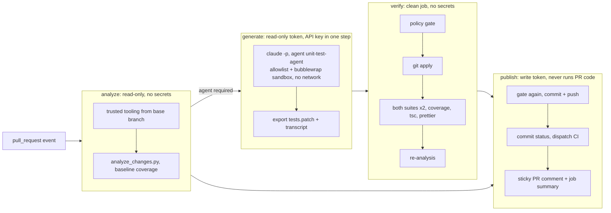

# Solution: unit-test agent and agentic PR workflow

A Claude Code **custom agent** with five **reusable skills** that adds and updates unit tests for
the FastAPI backend and the React frontend, and a **GitHub Actions workflow** that runs it on every
pull request, verifies its output independently and reports the result on the pull request.

| | Before | After |
| --- | --- | --- |
| Backend (pytest) | 21 tests, 42% lines | 81 tests, 100% lines and branches |
| Frontend (Vitest) | 18 tests, 46% statements / 44% branches | 128 tests, 100% statements, branches, functions, lines |

Example pull request: [#1 feat: clear completed tasks](https://github.com/JakubTuta/taskly-app/pull/1)
(see [Example run](#example-run)).

## Where things are

| Path | What |
| --- | --- |
| [`.claude/agents/unit-test-agent.md`](.claude/agents/unit-test-agent.md) | The custom agent: tool allowlist, model, rules, workflow, output contract. |
| [`.claude/skills/analyze-pr-changes/`](.claude/skills/analyze-pr-changes/SKILL.md) | Diff + **changed-line coverage** → per-file plan (`write_tests` / `review` / `skip`). |
| [`.claude/skills/run-tests/`](.claude/skills/run-tests/SKILL.md) | One runner for pytest and Vitest: targeted or full runs, coverage, `tsc`, repeated runs for flakiness, JSON report, credential-free environment. |
| [`.claude/skills/validate-test-changes/`](.claude/skills/validate-test-changes/SKILL.md) | Policy gate for a patch: test files only, no deletions/renames/symlinks, no `.skip`/`.only`/`xfail`, no secrets, size limits; warnings for weakened assertions. |
| [`.claude/skills/backend-unit-tests/`](.claude/skills/backend-unit-tests/SKILL.md) | How tests are written in this backend (fixtures, layer-by-layer patterns). |
| [`.claude/skills/frontend-unit-tests/`](.claude/skills/frontend-unit-tests/SKILL.md) | How tests are written in this frontend (design-system mocks, Query wrapper, fetch/timer patterns). |
| [`.github/workflows/unit-test-agent.yml`](.github/workflows/unit-test-agent.yml) | The agentic PR workflow. |
| [`.github/test-agent/`](.github/test-agent) | CI-only agent config (permissions + sandbox), output schema, task prompt, transcript summarizer, report renderer and their tests. |
| [`.github/workflows/ci.yml`](.github/workflows/ci.yml) | Regular CI: both suites with coverage gates (95% / 90% branches), type-check, formatting, tooling tests. |
| [`.claude/settings.json`](.claude/settings.json) | Lets developers run the skill scripts locally without permission prompts. |

## How it runs



1. **analyze** — checks out the PR head, replaces any `.claude/`, `CLAUDE.md`, `.mcp.json` from the
   PR with the versions from the **base branch**, runs both suites with coverage and computes, per
   changed file, which *changed* lines no test executes. If nothing unit-testable changed, the
   agent is not started (no cost) and the PR gets a short note.
2. **generate** — runs `claude -p --agent unit-test-agent` headless. The agent reads the analysis,
   invokes the skills, writes/updates tests, runs them, re-analyzes coverage, runs the gate, and
   returns a schema-validated JSON result. The job only exports a patch and the transcript.
3. **verify** — a fresh job that trusts nothing from the agent: gate the patch, apply it, run both
   suites twice with coverage, type-check and Prettier, recompute changed-line coverage.
4. **publish** — if verified: commit the patch to the PR branch as `github-actions[bot]`
   (only if the branch has not moved, with `[skip ci]` so no approval-pending runs appear), mark the
   commit with a `Unit test agent` status, dispatch `ci.yml` for it (which reports a `CI` status,
   because dispatched runs are not shown on PRs otherwise), and create or update one PR comment with
   decisions, skills used, test results, coverage before/after and run cost.

### Using the agent locally

The same agent and skills work in an interactive Claude Code session:

```sh
claude --agent unit-test-agent "Add tests for my changes against main"
```

or ask any session to use the `unit-test-agent` subagent. The skills are also directly usable, e.g.
`python3 .claude/skills/run-tests/scripts/run_tests.py --suite all --coverage --typecheck --repeat 2`
or `python3 .claude/skills/analyze-pr-changes/scripts/analyze_changes.py --all --run-coverage` for
whole-repository coverage mode (how the coverage uplift above was planned).

## Running the PR workflow

Prerequisites:

1. Repository secret **`ANTHROPIC_API_KEY`** (or `CLAUDE_CODE_OAUTH_TOKEN` from `claude setup-token`).
2. Actions enabled; the workflow declares its own least-privilege `permissions` per job.
3. Optional repository variables:

| Variable | Default | Meaning |
| --- | --- | --- |
| `TEST_AGENT_MODEL` | agent default (`sonnet`) | Model override, e.g. `claude-opus-5-5`. |
| `TEST_AGENT_MODE` | `commit` | `commit` pushes verified tests to the PR branch; `suggest` only attaches the patch to the comment. |
| `TEST_AGENT_MAX_BUDGET_USD` | `2` | Hard spend cap per run (`--max-budget-usd`). |
| `TEST_AGENT_MAX_TURNS` | `80` | Turn cap per run. |

It then runs on every non-draft pull request from a branch of this repository that touches
`backend/**` or `frontend/**`. Add the label `skip-test-agent` to opt a PR out; push a new commit or
re-run the workflow to retry.

## Main decisions

- **Claude Code CLI as the agent environment, invoked directly** (pinned `2.1.308`) rather than
  through a chat-style action: native subagents and skills, `--json-schema` structured output,
  `--max-budget-usd`, `dontAsk` permissions and a built-in Bash sandbox, with no GitHub token or
  GitHub tools inside the agent job.
- **Deterministic around the LLM.** What the agent should look at (changed-line coverage), whether
  its output is acceptable (policy gate) and whether it works (independent test run) are computed by
  scripts. The same scripts are skills the agent uses while working, so it is judged by the rules it
  was given. The report takes numbers from those steps and "skills used" from the transcript, not
  from the agent's self-report.
- **Skills split by concern**: process skills (analyze, run, validate) are generic; convention
  skills (backend, frontend) encode this codebase's test style, so new tests look like the
  existing ones (design-system mocks, autospec repository, `TestClient` with dependency overrides).
- **Commit to the PR branch by default** so the PR shows the tests in its diff and normal review
  applies; `suggest` mode exists for teams that do not want bot commits.
- **Sonnet 5.5 by default**: test writing does not need the most capable model; Opus is one
  variable away. Workflow changes can be smoke-tested end to end for cents by setting
  `TEST_AGENT_MODEL=claude-haiku-5-5` and `TEST_AGENT_MODE=suggest` (this is how the sandbox and
  path issues below were found before spending on a full run).

## Security

The PR content is untrusted input to an LLM, so the design assumes prompt injection is possible
and limits what a manipulated agent could do:

- **No write access where the agent runs.** The generate job has `contents: read`, checkout
  credentials are not persisted, and no GitHub token is in its environment. Only the publish job can
  write, and it never executes PR code: it applies a gated text patch and calls the GitHub API.
- **Trusted agent configuration.** Agent definition, skills, settings, prompt and scripts always
  come from the base branch; repository-provided `.claude/`, `CLAUDE.md` and `.mcp.json` are removed,
  MCP is disabled (`--strict-mcp-config`), hooks are disabled. A PR cannot change the rules it is
  checked by.
- **Least-privilege tools.** An allowlist in the CI settings: edits only to test paths, Bash only for
  the skill scripts, Prettier and read-only git; web tools and subagents denied. Headless runs never
  prompt, so anything else is denied (with the environment scrub enabled Claude Code switches
  `dontAsk` to `default`, which behaves the same without a human). Verified locally: writes to
  `backend/app`, reads outside the repo and arbitrary `node -e` are denied; in CI the denials are
  listed in the report.
- **Sandboxed execution.** Bash runs in Claude Code's bubblewrap sandbox with **no network**,
  writes limited to the workspace, `failIfUnavailable` and no unsandboxed escape hatch.
- **Secrets stay out of test processes.** `CLAUDE_CODE_SUBPROCESS_ENV_SCRUB=1` plus the runner's own
  environment allowlist; the API key exists only in the environment of the single `claude` step.
- **Output is gated twice and escaped.** The patch is checked in verify and again in publish
  (paths, traversal, symlinks, skipped tests, credential patterns). Agent-written text in the PR
  comment is HTML/Markdown-escaped, stripped of links and `@mentions`, redacted and length-limited.
- **Forks are skipped**: `pull_request` from forks gets no secrets; the job condition avoids failing runs.
- **Supply chain**: actions pinned to commit SHAs, CLI version pinned, `npm ci --ignore-scripts` for
  project dependencies.
- **Cost and loops**: per-run budget and turn caps, timeouts, `concurrency` cancels superseded runs,
  bot commits carry `[skip ci] [skip test-agent]` and a run on an agent commit never re-runs the agent.

## Reliability and correctness

- Generated tests must pass **twice** in a clean job (flake detection), type-check, and be
  Prettier-formatted; otherwise nothing is published and the verify job fails the check.
- The gate rejects skipped/focused tests and deleted test files, and warns when assertions are
  removed, so "make it green" shortcuts are visible.
- The agent must not change production code; if a test exposes a bug it drops the test and reports
  it under *suspected bugs* instead of enshrining the bug.
- Stale results are not pushed: the publish job compares the branch head with the analyzed commit.
- The tooling itself has 125 unit tests (`.github/test-agent/tests`), run in CI.

## Example run

[PR #1](https://github.com/JakubTuta/taskly-app/pull/1) adds **"clear completed tasks"**:
`DELETE /api/todos/completed` (repository bulk delete, new response schema, route registered before
`/{todo_id}`) and a *Clear completed (n)* button with a TanStack mutation hook wired into
`TodosPage`. It deliberately ships without tests, and it breaks existing ones: CI on the feature
commit [fails](https://github.com/JakubTuta/taskly-app/actions/runs/40025606838) (backend route
inventory test; 17 `TodosPage` tests, because the page now calls a hook the test does not mock).

Agent workflow [run 40025606837](https://github.com/JakubTuta/taskly-app/actions/runs/40025606837)
(Sonnet 5.5, 39 turns, 1.4 minutes, **$0.27**):

1. **Analyze** — 8 changed files: 6 `write_tests` with exact uncovered changed lines
   (e.g. `repository.py` 51–53, `TodosPage.tsx` 48–51, 59, 81), 2 declarative files to review;
   10 of 27 changed executable lines covered; baseline: 1 backend and 17 frontend failures.
2. **Generate** — skills used, in order: `backend-unit-tests` → `frontend-unit-tests` → `run-tests`
   → `analyze-pr-changes` → `validate-test-changes`; no command was denied by the policy.

   | Changed file | Decision | Tests |
   | --- | --- | --- |
   | `backend/.../repository.py` | updated tests | compiled `DELETE … WHERE completed` statement, commit, returned rowcount incl. zero |
   | `backend/.../router.py` | updated tests | `DELETE /api/todos/completed` body and repository call; **updated** the route inventory in `test_factory.py` as an intentional change |
   | `backend/.../schemas.py` | no change | declarative, asserted through the router response |
   | `frontend/.../TodosPage.tsx` | updated tests | **mocked the new hook** (fixing the 17 failures), notices (singular/plural), busy guard, silent failure, error precedence, reset on retry |
   | `frontend/.../api/todos.ts` | updated tests | request method/path and returned count |
   | `frontend/.../api/queryKeys.ts` | no change | declarative, used by the hook tests |
   | `frontend/.../ClearCompletedButton.tsx` | created tests | hidden at zero, label with count, click, disabled |
   | `frontend/.../useClearCompletedMutation.ts` | created tests | cache pruning, no cache created, query cancellation, cache kept on failure |

3. **Verify** (clean job) — gate passed with no warnings (7 files, +203/−0 lines); backend 85/85 and
   frontend 144/144 passed **twice**, type-check and Prettier clean, 100% coverage in both suites,
   changed executable lines covered **10/27 → 27/27**.
4. **Publish** — commit [`c2285d2`](https://github.com/JakubTuta/taskly-app/pull/1/commits/c2285d2a4025bb0d16e69368ecbaa9ae5a326130) by
   `github-actions[bot]`, `Unit test agent` status, dispatched
   [CI](https://github.com/JakubTuta/taskly-app/actions/runs/40026109318) green with the coverage
   gates, and the [report comment](https://github.com/JakubTuta/taskly-app/pull/1#issuecomment-6374573819)
   with the tables above, failures before the agent ran, and run details.

All CI agent runs for this assignment (two Haiku dry runs and three Sonnet runs while finishing the
workflow) cost about **$0.90** in total.

### Issues found while running the workflow

Two end-to-end dry runs with `claude-haiku-5-5` in `suggest` mode (about $0.02–0.03 each) and the
first Sonnet run exposed problems that local testing could not. Each was fixed on `main`, with a
regression test where the cause was in the tooling:

| Symptom | Cause | Fix |
| --- | --- | --- |
| Baseline showed 0 tests in CI | Relative `--output` while pytest/Vitest run from `backend/` and `frontend/` | Resolve report paths up front |
| Vitest could not load its config inside the sandbox | The sandbox mounts an empty placeholder for a missing root `package.json` | Create a minimal one in the CI workspace |
| `getaddrinfo EAI_AGAIN localhost` inside the sandbox | Vite resolves `localhost` through DNS when no host is configured | `server.host: '127.0.0.1'` in `vite.config.ts` |
| No frontend coverage on PRs that break tests | Vitest skips coverage reports on failing runs | `--coverage.reportOnFailure` |
| Bot commit left approval-pending runs on the PR | Runs triggered by the Actions bot need approval | `[skip ci]` on bot commits |
| Green dispatched CI not visible on the PR | `workflow_dispatch` check suites are not shown on pull requests | `CI` and `Unit test agent` commit statuses |

Even blocked by the sandbox, the first dry run behaved as designed: it reported `blocked`, kept
only the backend tests it could verify, and nothing was published because verification failed.

## Assumptions

- PRs come from branches of this repository; people who can push here are trusted to run CI with
  the API key (the usual model for `pull_request` workflows).
- "Unit test" means isolated tests at the boundaries the project already uses: routers with a mocked
  repository, repository with a mocked session, components with mocked design system and hooks.
  No database or browser is started.
- The project's own coverage configuration defines what is worth testing (design system, entry points,
  schemas and types are excluded there and by the analysis).

## Limitations

- Fork PRs are not processed (no secrets on `pull_request` from forks).
- The workflow file itself is taken from the PR (GitHub's `pull_request` semantics); protecting
  `.github/` with CODEOWNERS and branch protection is needed for full trust.
- `GITHUB_TOKEN` commits do not trigger workflows, so CI is dispatched explicitly and reports a `CI`
  commit status; branch protection should require that status (or a GitHub App token should push).
- Changed-line coverage shows that code runs, not that it is asserted on; `review` decisions rely
  on the agent's judgement. Mutation testing would close this gap.
- LLM output varies between runs; the gate and verification make the result safe, not deterministic.
- The Bash sandbox needs Linux (bubblewrap); locally on Windows the agent runs without it.

## Production version

- GitHub App identity with a fine-grained token so bot commits trigger required checks, and
  `workflow_run`-based publishing for fork PRs (agent output from forks would stay suggest-only).
- Mutation testing (mutmut / Stryker) on changed lines as an extra verification signal.
- Run the whole agent job in an ephemeral container or VM with egress limited to the Anthropic API.
- `/test-agent` comment trigger for re-runs with instructions from maintainers only.
- Cost and outcome metrics per run (tokens, acceptance rate of agent commits, reverted tests).
- Evaluation set of past PRs to regression-test changes to the agent prompt and skills.
